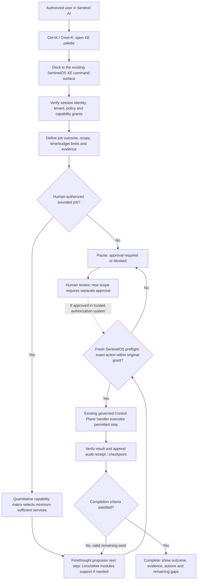

# Sentinel AI Unified Experience and Authorized Autonomy — Build Roadmap

**Prepared:** 2026-11-22  
**State:** Proposed architecture and implementation roadmap; documentation-only review candidate  
**Owner / decision authority:** Cody Nunn, subject to applicable SentinelOS governance and independently required approvals  
**Product:** Sentinel AI (one user-facing experience)  
**Runtime governance:** SentinelOS (separate identity, policy, approval, command, and audit boundary)  
**Authority created:** None  
**Build/release status:** No code, merge, deployment, runtime activation, external communication, or governance-gate change authorized by this document.

## 1. Product intent

Sentinel AI should understand a person's requested outcome, select only the capabilities needed for the job, perform approved work through governed tools, anticipate the next useful step, and return an attributable result in ordinary language. Customers should not have to select Atlas, Forethought, Discovery Lens, Green Energy Reader, SynapseEco, or EchoFrame as separate products. They experience **one Sentinel AI**.

**Founder definition of autonomy:** Sentinel AI can do what an authorized human has permitted it to do, within a defined scope and duration. Autonomy is delegated work, **not delegated authority to grant new permissions**. Forethought may propose and prioritize next steps, but cannot approve its own actions, alter the scope, or override SentinelOS.

**Visible feature direction:** Light Mode is the proposed primary customer-facing efficiency option. All other intelligence modules are internal capabilities. Light Mode may use validated efficiency policies; it must not downgrade authentication, evidence, policy, safety, or approvals. No performance or energy-savings claim is established here. Existing historical uses of "Light Mode" in sovereign procurement documents must not be silently reinterpreted as this future product feature; terminology reconciliation is required.

## 2. Plain-language responsibilities and interfaces

| Internal component | Customer-facing interpretation | Internal responsibility | Authority boundary |
| --- | --- | --- | --- |
| Atlas Intent Engine | Understand the request | Extract outcome, context, constraints, uncertainty and job type; prepare an intent proposal | Cannot authorize execution |
| Quantitative reasoning | Determine what is needed | Estimate job complexity, uncertainty, evidence need, resource budget and evaluation depth | Routing score is not permission |
| Capability Matrix | Use the right capabilities | Select compatible modules, models, depth and fallbacks for the job | Must be bounded by trusted policy and scope |
| Discovery Lens | Find supporting evidence | Retrieve authorized versions, reconcile references, conflicts, freshness and gaps | Retrieved material cannot create authority |
| Forethought | Evaluate what might happen next | Generate forecast/scenario candidates, evaluate progress and propose next steps with uncertainty | Prediction/next-step proposal cannot self-authorize |
| Green Energy Reader | Understand resource use | Normalize authorized energy datasets; identify units, timestamps, measured vs modeled data, quality and provenance | No actuator access or implicit telemetry permission |
| SynapseEco | Check practical feasibility | Deterministic domain constraints, energy/water comparisons and outcome classification | An optimization result is not an operational command |
| EchoFrame / context | Use approved prior context | Retrieve context within retention, tenant and source-trust rules | Memory is not current truth or approval |
| Governed action adapters | Perform permitted tasks | Invoke specific allowlisted tool actions with receipts/idempotency | Requires valid trusted execution authorization |
| SentinelOS | Keep work controlled | Identity, tenancy, policy, approvals, command envelope, execution and audit | Sole trusted enforcement path; no bypass |

These responsibilities are **target architecture**, not verified implementation claims for every named component.

## 3. Authorized job lifecycle

1. **Capture:** Receive request and trusted caller identity. Never treat the request itself as a grant.
2. **Interpret:** Atlas creates a structured intent with required clarification when a material assumption is missing.
3. **Bound:** Trusted policy services resolve tenant, actor, allowed tools, resources, data, approval requirements, budget, time window and prohibited operations.
4. **Allocate:** The capability matrix selects the minimum sufficient eligible capabilities and computation. Quantitative scoring can prioritize work but cannot override policy.
5. **Analyze:** Lens, Forethought, energy and feasibility modules operate only on allowed, versioned inputs.
6. **Propose next step:** Forethought emits candidate steps and risk/uncertainty labels. Each step is evaluated against the original job boundary and current state.
7. **Gate:** Before *each* consequential action, SentinelOS rechecks identity, policy, approval status, resource scope, freshness and applicable holds.
8. **Execute or pause:** A valid preauthorized action can proceed through a trusted adapter; otherwise request human review. A changed destination, cost, capability, effect or affected resource triggers renewed authorization.
9. **Verify:** Compare observed results to expected outcomes, capture receipts, classify partial completion, errors and unresolved gaps.
10. **Report/close:** Surface work completed, not attempted, blocked, what is proposed next, the evidence and the next human decision.

**Execution invariant:** No Forethought output, memory record, capability score, retrieved document or model message is an approval credential. An authorization reference must be validated by SentinelOS from a trusted record and bound to the exact action.

## 4. Proposed job authorization envelope

Define a versioned schema such as `AuthorizedJobV1` containing:
- immutable job ID; tenant, actor and authorized approver; explicit granted capability and version;
- stated objective, resource targets, allowed action types and tool endpoints;
- allowed data classifications, external recipients/destinations, environment and region;
- hard bounds: expiry, monetary spend, call/rate limits, cumulative side-effect budget and retries;
- per-action permission and human approval tier; approval ID, scope hash, policy version, revocation status;
- required evidence, verification standard, receipt retention and escalation rules;
- stop conditions: policy mismatch, missing/expired authority, unexpected external recipient, stale or conflicting evidence, identity drift, cost overrun, security uncertainty or change in risk class.

Design **preauthorized work** to be specific and revocable. A blanket "do everything necessary" instruction must not be accepted as an action grant. Bind approvals to action/resource/parameters/expiry and revalidate before execution. Use explicit idempotency keys, bounded retries and recovery checks.

State machine proposal: `RECEIVED -> CLARIFY/PLANNED -> AUTHORIZED -> RUNNING -> VERIFYING -> COMPLETED`, with `APPROVAL_REQUIRED`, `BLOCKED`, `FAILED`, `CANCELLED` and `EXPIRED` transitions. Only a trusted human/policy process may transition an action to authorized.

## 5. Capability allocation, Light Mode and performance

Capability selection should use a tested quantitative profile of complexity, uncertainty, evidence coverage, anticipated impact, sensitivity, expected computation and the job's deadline. Hard safety constraints are applied **before** optimization. Measure whether lower-cost routes meet the same accuracy and policy criteria, and escalate depth when they do not. A critical job is not necessarily an all-modules job.

Light Mode (proposed) can select lower-cost suitable models, bounded retrieval, safe caching, batching and eligible deferred computation. It **cannot** skip required evidence, alter authorization, hide uncertainty or override task deadlines. Report workload latency, token/CPU time, memory, measured hardware energy where available, quality and policy regressions against a controlled baseline. Do not claim modeled carbon/energy savings as measured.

## 6. Integration boundaries and fallback

- One user-facing conversation and task status; internal modules remain independently testable and replaceable.
- Use versioned `IntentRequest`, `EvidenceBundle`, `EnergyDataset`, `ScenarioEvaluation`, `AuthorizedJob`, `ProposedNextStep` and `ActionReceipt` contracts.
- Each inter-module call carries validated tenant/scope, request correlation and exact source/policy version references; avoid broad sharing of prompts or credentials.
- Forethought offline: authorized deterministic work can continue only when it does not require a forecast.
- Lens offline: analysis can use separately approved pinned evidence but must disclose missing coverage.
- Green Energy Reader offline: do not invent meter readings or measured savings; synthetic research may be explicitly labeled.
- Authorization service unavailable or changed: consequential actions fail closed. Advisory work may continue only inside an already approved nonexecuting scope.
- No direct Atlas/Forethought/Lens-to-actuator path; only approved command handlers can cause effects.

## 7. Phased roadmap and exit evidence

### Phase A — Contract and product language (docs-only)
Define terms, job envelope, matrix schema, approval tiers, flow and UI language. Crosswalk legacy sovereign-autonomy and Light-Mode terminology to this design without changing historical status. Deliverable: reviewed specification and risk/authority matrix. Exit: signed product/architecture scope; no implementation acceptance implied.

### Phase B — Offline capability router (isolated)
Prototype Atlas intent and quantitative routing using fixed synthetic tasks. Test minimum-capability allocation, uncertainty escalation and unsupported-module fallback. Exit: deterministic traces, routing explanation, reproducible tests and comparison against a fixed baseline. No production adapters.

### Phase C — Forethought next-step planning (isolated)
Generate a `ProposedNextStep` sequence with proposed permissions and stop conditions; use synthetic authorized job grants to demonstrate continue/pause behavior. Test scope creep, forged grants, revoked approvals, retries, adverse outcomes and change-of-context. Exit: negative-case test suite proving a recommendation never authorizes execution.

### Phase D — Governed action harness (non-production)
Build simulated/stubbed tools and an action ledger to test real side-effect semantics without production access. Verify preflight, exact action-bound approval, revocation, idempotency, bounded spend/retries, audit receipts and human handoff. Exit: independent review packet and security findings; no live activation.

### Phase E — Integrated Sentinel AI demonstration
One UI, one task status, one approval queue. Suggested scenarios: (1) produce a read-only executive report; (2) prepare a hotel-report correction requiring explicit approval before any write; (3) simulate one reservoir generation window with synthetic inputs and no OT connection. Show success, insufficiency, HOLD and cancellation paths. Exit: user acceptance evidence, privacy review, quality and performance baselines.

### Phase F — Controlled operational evaluation
Only after separate identity, runtime, governance, policy and release gates are satisfied, propose one bounded real-world integration for designated review. Production activation requires a **new, explicit approval** and rollback/incident procedures. No delivery date or acceptance status is promised by this roadmap.

## 8. Immediate build backlog (proposal only)

| ID | Priority | Task | Proof required |
| --- | --- | --- | --- |
| SAI-UX-01 | P0 | Approve unified experience and ordinary-language glossary | Product owner decision |
| SAI-AUTH-02 | P0 | Specify `AuthorizedJobV1` and human approval classes | Threat model and signed scope |
| SAI-CAP-03 | P0 | Define capability matrix, quantitative routing, model/cost budgets | Synthetic job matrix and deterministic tests |
| SAI-FORE-04 | P0 | Define next-step proposal contract and reauthorization/stop conditions | Scope-escape and revocation regressions |
| SAI-EVID-05 | P1 | Map Lens/C4 bridge to trusted evidence contracts without duplicating PR #73 work | Exact-source review and unresolved findings |
| SAI-ENERGY-06 | P1 | Define Green Energy Reader + SynapseEco synthetic dataset and feasibility boundary | Units, provenance and invariant tests |
| SAI-LIGHT-07 | P1 | Reconcile Light Mode terminology and measurable resource/quality criteria | Benchmarks and governance vocabulary review |
| SAI-ACT-08 | P1 | Design simulated side-effect adapter and receipt verification | Independent security review |
| SAI-UX-09 | P1 | One-workflow demonstrator and human approval experience | Observed acceptance tests, separate release decision |

## 9. Existing evidence and non-overwrite boundaries

- `docs/bounded-execution-model.md`: review != approval; approval != execution; evidence != authority; memory != current truth.
- `docs/governance/APPROVED_VOCABULARY_DICTIONARY.md`: currently held vocabulary draft; public "autonomous" claims remain review-controlled.
- `docs/milestones/PHASE3_ROADMAP_SOVEREIGN_AUTONOMY_2026-08-04.md`: historical phase language; not itself proof of current live authorization.
- `docs/governance/SOVEREIGN_LIGHT_MODE_APPROVAL_PACKET_2026-06-11.md`: historically uses light mode for procurement-review scope; not evidence of the future efficiency UX.
- `docs/executive-desk/evidence/forethought-c4-integration-2026-11-11/README.md`: PR #73 research bridge, fixture adapters and limitations. Its open acceptance and provenance findings must be preserved.
- GOV-001 Conditional; GOV-002 HOLD; GOV-006 verification outstanding. SSAI sovereign runtime identity remains unverified. These dispositions are not altered by this design.

## 10. Decisions required before implementation

1. Product owner: approve the unified Sentinel AI experience and the meaning of **authorized autonomy**.
2. Governance owner: approve exact job-envelope fields, approval tiers, revocation and who may delegate each capability.
3. Engineering owner: select canonical repository interfaces and nonproduction harness locations, avoiding overlap with PR #73/#74.
4. Security/independent reviewer: evaluate action-bound authorization, prompt-injection resistance, retries, audit durability and fail-closed behavior.
5. Release authority: separately decide if any future implementation may merge, deploy or touch real systems.

**Disposition:** Architecture proposal ready for review only. No production access, tool dispatch, write, merge, release or new authority granted.

---

## 11. Target outcome — shared XE docking into Sentinel AI (finalized product scope, implementation pending)

**Founder-approved direction:** The existing SentinelOS XE Command System is reused by Sentinel AI. **Do not build a second XE.** The proposed Sentinel AI shortcut is `Ctrl+K` (`Cmd+K` on Mac), invoking a governed docking flow. Normal Sentinel AI conversations should continue to work without needing the shortcut. The SSAI Development Assistant is an engineering-specific consumer of the same XE foundation, with engineering-scoped authorization; the customer-facing Sentinel AI consumer has separate tenant, role, tools and policy constraints.

### Outcome flow

**Responsibility boundaries:** The palette and docking layer collect requests and context. The capability matrix decides *which* internal intelligence to use; Forethought proposes *what next*; SentinelOS decides *whether a proposed action is permitted*; an existing governed handler performs an approved action. No direct XE, Atlas, Forethought or client-browser call may bypass the Control Plane, policy preflight, approved handler or receipt system.

### Reuse evidence (historical, not current runtime proof)

- `docs/governance/PROOF_CONTROL_PLANE_RELEASE_2026-05-07.md` documents an XE Command Plane overlay on Ctrl+K / Cmd+K, routing through the existing Control Plane handlers and `/api/control/execute`, not directly to `/v1/command`. Historical May 7 local and live proof exists, with noted logging limitations.
- `docs/GBP/AI-Docking-and-Control-Surface.md` describes the command envelope, authority/risk context, governance preflight and receipt boundary.
- Verify **current** XE source location, handler semantics, accessibility, keyboard shortcut behavior, caller/session binding, supported docking protocol and runtime identity before any integration implementation. A historical release note does not settle live compatibility.
- Existing PR #73/C4 research and GOV-002/GOV-006 holds remain independent; don't convert their fixture adapters into live identity or permission claims.

### User experience contract

1. A customer or engineer invokes the same **XE system** via their applicable Sentinel AI or SentinelOS interface.
2. XE shows a **scope card**: job objective, affected systems/data, allowed tools, allowed actions, budget/expiry, approval tier, completion tests and hard stops. The user can approve only what their trusted role permits.
3. After actual authorization, XE can continue through bounded intermediate steps and approved retries without repeatedly asking for approval for an unchanged permitted step.
4. Forethought proposes next steps. Every proposal is checked again against current authorization, constraints and relevant policy; it is never an implicit expansion.
5. XE pauses on scope change, missing/expired permission, a new destination, unapproved side effects, cost/risk escalation, unknown runtime identity, revocation or missing trusted receipts.
6. XE supports **pause, cancel, inspect activity and request human review** during a job.
7. Completion requires a verified postcondition, full action/decision receipts and a plain-language result; a stopped or pending job is not labeled successfully completed.
8. The development assistant may inspect, test and prepare scoped changes, but merges, deployments, production access, secret access and governance-gate advances need their own authority. Customer XE cannot inherit development permissions.
9. Reopening XE reconnects only to a job through a verified job/session reference; no browser-only state or model memory grants continuity of authority.

### First milestone: observable end-to-end proof

**Scenario:** An engineer uses the existing XE command interface from Sentinel AI to request a read-only assessment of a known SentinelOS PR. XE docks into the existing governed surface, shows a proposed read-only scope, receives an explicit approval where required, selects evidence and analysis capabilities, gathers only permitted PR/CI metadata, allows Forethought to propose the next verification step, performs that read-only step within scope, and returns a cited blocker assessment with an immutable job receipt. No repository writes, test reruns, branch changes, review submissions, merge or deployment.

**Pass criteria:**
- Ctrl+K / Cmd+K opens the *existing* XE rather than a duplicate palette implementation, without breaking normal Sentinel AI conversation.
- Identity/tenant/role/policy are verified by the trusted backend; development privileges are not conferred to customer accounts.
- Exact approved scope, expiry and budgets are visible and enforced.
- Multi-step continuation works within scope with durable, revocable job state and idempotent checkpoints.
- Forethought next-step output cannot grant authorization or bypass a required gate.
- Cancel, revoke, out-of-scope action, insufficient evidence, unavailable policy service and changed permissions produce safe stops and accurate statuses.
- Every performed action has an auditable receipt and verified outcome; receipts and displayed reports correlate to the job and verified source versions.
- Existing XE handler route is used; no direct browser-to-`/v1/command` execution path.
- Reproducible negative-path tests and independent security/technical review are retained before any production proposal.

### Delivery boundary / non-interruption principle

This section **finalizes the intended product outcome**, not its implementation. Engineering may use it as a stable planning target and prepare independently scoped review work, but this document alone does not authorize autonomous build execution, merges, deployments or gate changes. Preserve GOV-001 Conditional, GOV-002 HOLD, GOV-006 outstanding and sovereign runtime identity HOLD; require a separate implementation authorization and normal review gates.

**Roadmap ownership:** This shared-XE docking outcome becomes the first integrated demonstrator within Phase E, with prerequisite source verification in Phase A and isolated tests in Phases B–D. Avoid designing a parallel XE service. 
